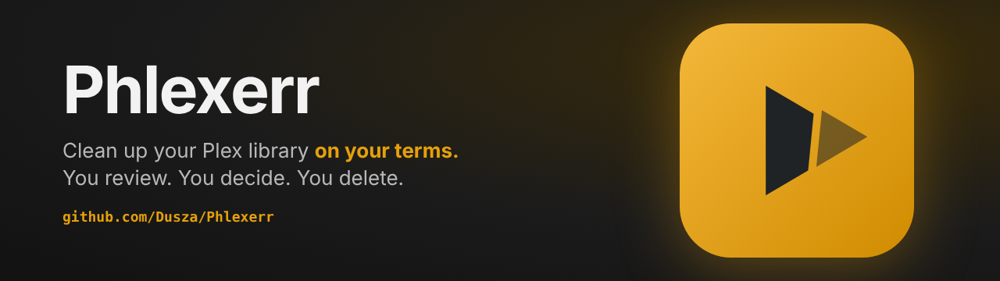
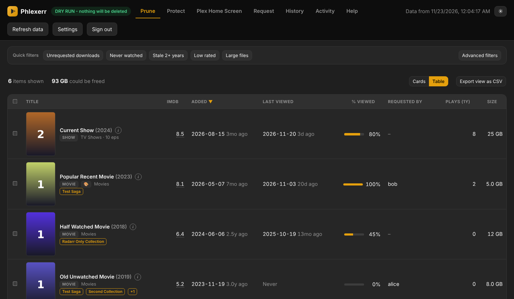
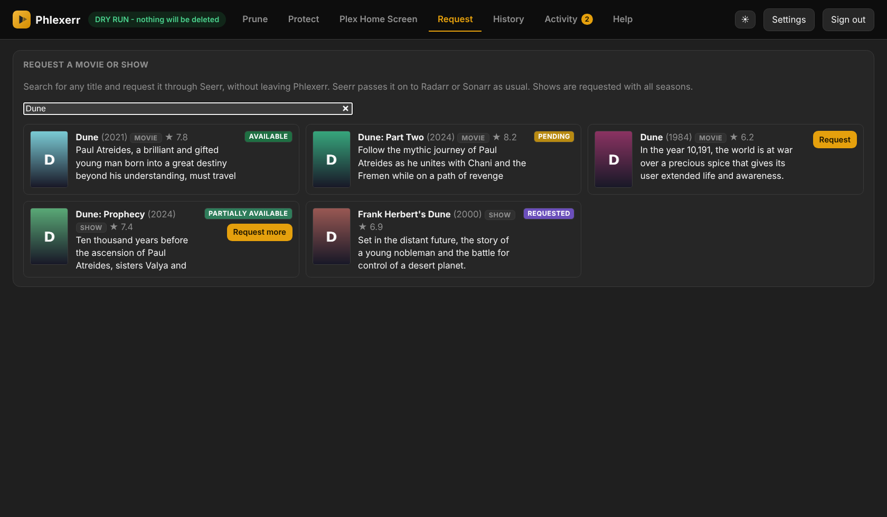
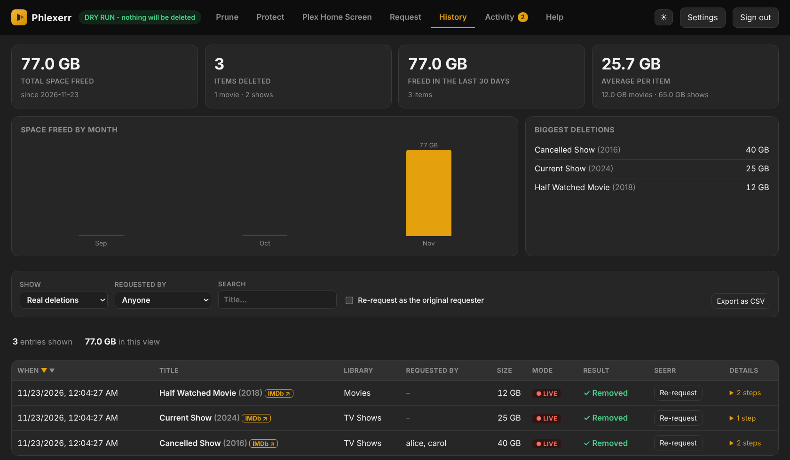
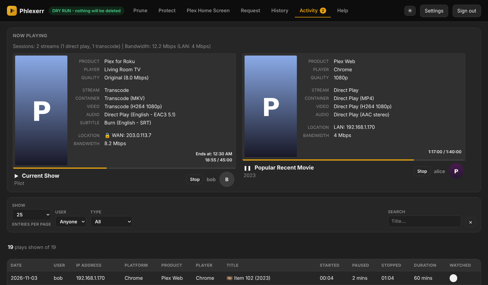
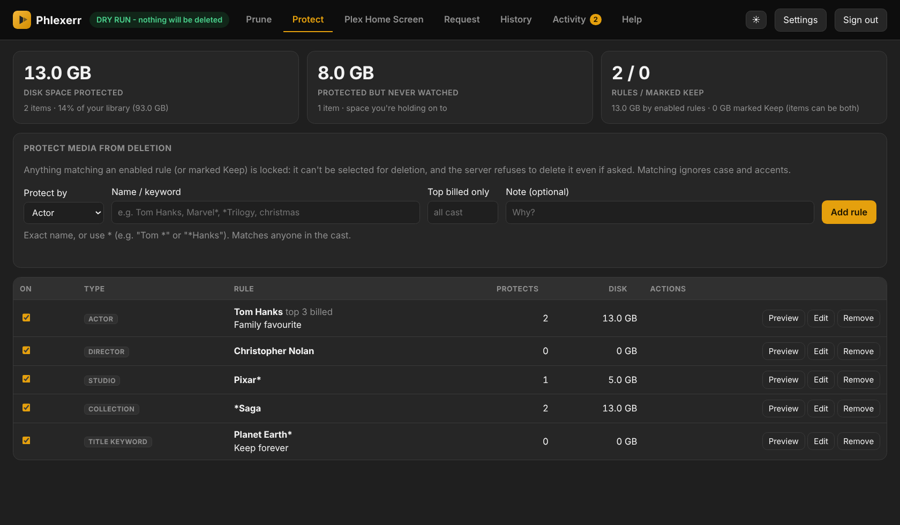

<p align="center">
  
</p>

<p align="center">
  <b>Pronounced "flex-er"</b> (Plex + "ph" + "err")<br>
  <i>Review what is worth deleting. You decide. Nothing is removed on a timer or behind your back.</i>
</p>

<p align="center">
  <a href="https://github.com/Dusza/Phlexerr/actions"></a>
  <a href="LICENSE"></a>
  
  
  
</p>

<p align="center">
  <a href="#install">Install</a> &bull;
  <a href="#required-vs-optional">What you need</a> &bull;
  <a href="#first-run-setup">First-run setup</a> &bull;
  <a href="#safety">Safety</a> &bull;
  <a href="docs/FEATURES.md">Feature guide</a> &bull;
  <a href="#how-it-compares">Compare</a>
</p>

---

Born from a simple problem: **your users request everything.** Every "just one more season" and "I'll definitely watch that someday" lands on your server, and the drives fill up. Phlexerr is how you take the library back, kindly and on your own schedule.

Most cleanup tools run rules on a schedule and delete for you. Phlexerr is built for people who would rather look first and click the button themselves, with a safety net around every click.

<p align="center">
  
  <br><sub>Prune: see exactly what is worth deleting and how much space you'd get back. (Screenshots use demo data.)</sub>
</p>

## Why Phlexerr

**You are always the one who deletes.** No schedules, no background deletions, no "the rule matched at 3 a.m." surprises. Every delete is a button you pressed.

**Review before you act.** A sortable list or card view with ratings, file sizes, last-watched dates and who requested each title, so you can make the call with the facts in front of you.

**Tame the request button.** See who requested each title and whether anyone ever pressed play. Prune it, and if they really do want it back later, they can request it again. You can even search and request new titles from inside Phlexerr.

**See the space you win back.** Every selection shows how much it will free before you confirm, and the History tab keeps a running total of what you've reclaimed.

**Dry-run by default.** You get an exact report of what *would* happen until you choose to turn deleting on, and that switch can't be flipped from the web page.

**Protection that actually protects.** Lock titles by actor (even top-billed only), director, studio, collection or keyword. Protected titles can't be selected, and the server refuses them even from an old page.

**Warn people first, only if you want to.** An optional, off-by-default **Leaving Soon** row puts titles you picked on your Plex Home with a date. When the date passes, nothing happens until you delete them.

**Starts with only Plex.** Tautulli, Radarr, Sonarr and Seerr are optional extras, and the app works around any you don't have.

## A tour

<table>
  <tr>
    <td width="50%"><br><b>Request</b><br>Search any movie or show and request it through Seerr. Status badges (Available, Pending, Requested, Partially available) match what Seerr shows.</td>
    <td width="50%"><br><b>History</b><br>Everything you've deleted, the space freed, and a one-click Re-request if you change your mind.</td>
  </tr>
  <tr>
    <td width="50%"><br><b>Activity</b><br>Live "now playing" cards, a full watch history, and a Stop button (with an optional message to the viewer). Needs Tautulli.</td>
    <td width="50%"><br><b>Protect</b><br>Lock favorites by actor, director, studio, collection or keyword so they can never be selected.</td>
  </tr>
</table>

### How it compares

These tools overlap a little but solve different problems. Pick by what you want done.

| | **Phlexerr** | [Prunerr](https://github.com/helliott20/prunerr) | Maintainerr | Janitorr | Cleanuparr | Checkrr |
|---|---|---|---|---|---|---|
| Main job | Review and delete by hand | Rules feed a review queue with grace periods | Rule-based media cleanup | Automatic media cleanup | Clean stalled or failed downloads | Find corrupt media files |
| Who decides what is deleted | **You, with a review screen** | Rules, then you approve | Rules, on a schedule | Rules, on a schedule | Rules (download queue, not your library) | Reports problems |
| Manual, title-by-title control | **Yes, it is the whole design** | Approval queue | Limited | Limited | No | No |
| Dry-run before anything happens | **Yes, on by default** | Not described | Varies by setup | Yes (setting) | Yes (setting) | Report-only |
| Warn viewers before removal | Optional Leaving Soon row | Upcoming-deletions view | Yes, automated | Yes, automated | No | No |
| Search and request titles (Seerr) | **Yes, with status badges** | Resets Seerr requests on delete | No | No | No | No |
| Custom Plex Home rows | **Yes** | No | Collections | No | No | No |
| Live "who is watching" and Stop stream | **Yes** (with Tautulli) | No | No | No | No | No |
| Space-freed history | **Yes** | Storage trends | No | No | No | No |
| Jellyfin / Emby | No (Plex only) | Yes | Yes (Jellyfin) | Yes | n/a | n/a |
| Needs Radarr / Sonarr | **No, optional** | Recommended | Optional | Yes | Yes | Optional |

*Based on each project's public description at the time of writing; those projects change, so check their pages before deciding.* They are good at what they do, and they can run alongside Phlexerr. If you want rules and automation, or you don't use Plex, look at them. If you want to see your library, decide, and press the button yourself, use Phlexerr.

## What it does

- **Prune:** find movies and shows worth deleting (never watched, stale, low rated, large, unrequested downloads) and delete them, optionally cleaning up Radarr, Sonarr and Seerr at the same time.
- **Protect:** lock titles so they can never be deleted.
- **Plex Home Screen:** build your own Home rows from criteria or IMDb/MDBList lists, and request what's missing through Seerr.
- **Request:** search for any movie or show and request it through Seerr, with live status badges (needs Seerr).
- **Activity:** live "now playing" cards, a full watch history, and a Stop button for a stream (needs Tautulli).
- **History:** everything deleted, and the space freed.
- **Leaving Soon (optional):** warn viewers before you delete, without automating anything.

> **Phlexerr can permanently delete files.** It starts in **dry-run mode**, where nothing is deleted and you get a report of what would happen. Read [Safety](#safety) before you turn dry-run off.

*Phlexerr is an independent project and is not affiliated with or endorsed by Plex, Tautulli, Radarr, Sonarr, Seerr or IMDb. Those names belong to their owners.*

## Required vs optional

**Required (you can't start without these):**

| What | Why | Where it goes |
|---|---|---|
| **Docker** | Phlexerr runs as a container | Unraid already has it |
| **An app password** | Protects the web page | Container setting `APP_PASSWORD`. **Default: `obiwan`** (see below) |
| **A folder for its data** | Keeps your settings and history between updates | Mapped to `/config` (the template does this for you) |
| **Plex URL and Plex token** | The library it works on | Settings page (or container settings) |

**Optional (add any, any time, from the Settings page):**

| Service | What you gain | What happens without it |
|---|---|---|
| Tautulli | Play counts and last-watched across *all* users, plus the **Activity** tab | Play data comes from your own Plex account only, and Activity asks you to connect it |
| Radarr / Sonarr | Real file sizes and ratings, and deleting through them | Titles are deleted through Plex instead |
| Seerr (Overseerr / Jellyseerr) | "Requested by", re-requesting deleted titles, requesting missing titles | Those parts are hidden and the app says why |
| MDBList key | Following private MDBList lists | Public lists work without it |

You don't need to fill in anything optional up front. **DRY_RUN** is also a container setting; it defaults to `true` (safe) and you only change it when you are ready to delete for real.

## Install

Pick one.

### Unraid (ready-made image)

1. Download `Phlexerr.xml` from this repository and copy it to `/boot/config/plugins/dockerMan/templates-user/` on your server.
2. Docker tab, **Add Container**, pick **phlexerr** from the template dropdown.
3. Leave **DRY_RUN** as `true`. The **App password** is pre-filled with the default, `obiwan`, so you can just click Apply to get started. **Change it** before anyone else can reach the page. That is all the container needs. Plex and the optional services are entered on the web page next. Click **Apply**.
4. Open `http://YOUR-SERVER-IP:8080`, sign in, and Phlexerr will ask for your Plex details.

### Docker Compose

```
git clone https://github.com/Dusza/Phlexerr.git && cd phlexerr
cp .env.example .env        # optional: set APP_PASSWORD (default is obiwan)
docker compose up -d --build
```
Open `http://localhost:8080`. Your settings are stored in `./data`.

### Docker run

```
docker run -d --name phlexerr --restart unless-stopped -p 8080:8080 \
  -e APP_PASSWORD='choose-a-password' -e DRY_RUN=true   # leave APP_PASSWORD out to use the default, obiwan \
  -v /path/to/phlexerr-data:/config ghcr.io/dusza/phlexerr:latest
```
The container runs as user `99:100`. If the data folder isn't writable, run `chown 99:100 /path/to/phlexerr-data`.

### Build it yourself instead

```
docker build -t phlexerr:latest .
```
Then use `phlexerr:latest` as the image name in the commands above (on Unraid, edit the template's Repository field).

## First-run setup

1. Open the web page and sign in. If you didn't set one, the password is **`obiwan`**.
2. Click **Settings** and enter the **Plex URL and token**. Everything else is optional (Tautulli, Radarr, Sonarr, Seerr). Each one has a **Test connection** button. **Leaving Soon** is also optional and off until you enable it.
3. Click **Save & refresh data**. The first refresh reads your whole library and can take a few minutes.
4. Browse **Prune**. Nothing is deleted while the **DRY RUN** badge is showing.

Use your server's LAN IP in the URLs (for example `http://192.168.1.10:32400`), not `localhost`.

| Setting | Where to find it |
|---|---|
| Plex token | Plex web, any item, the **⋯** menu, **Get Info**, **View XML**, then `X-Plex-Token` in the address bar |
| Tautulli key | Tautulli, Settings, Web Interface, API key |
| Radarr / Sonarr key | Settings, General, API key |
| Seerr key | Settings, General, API key |

### Where your keys are stored

Keys entered on the Settings page are saved in `settings.json` in your data folder (`/config` in the container), readable only by the container's user. They are never sent back to your browser once saved. Keys given as container environment variables stay in the container definition. Anything saved on the Settings page overrides the environment. **Never share your data folder or your Unraid template file.**

## Safety

- **Change the default password.** Phlexerr starts with the password `obiwan` so the first install is quick, and it shows a warning banner until you set your own. Never expose it to the internet with the default.
- **Dry-run is on by default.** It can only be switched off with `DRY_RUN=false` on the container, never from the web page, so a stolen login can't turn on deleting.
- **Nothing is ever deleted automatically.** There are no schedules. Even the optional Leaving Soon row only *labels* titles; when a date passes, the title stays until you delete it.
- Real deletes need you to type `DELETE` in a dialog that lists every item and the space it will free.
- Protected and **Keep** items can't be selected, and the server refuses them even from an old page.
- Every attempt, real or dry, is written to the deletion log and shown on the History tab.
- Batches are limited (200 by default).
- If removing a title from Radarr/Sonarr fails, Seerr is left alone for that title.

## Updating

- **Ready-made image:** pull the new image and recreate the container. On Unraid, use the Docker tab's **Check for updates** and **Apply update**. Your `data` folder is kept.
- **Built from source:** pull the new code, run `docker build` again (or `docker compose up -d --build`), and recreate the container.

Hard-refresh the browser afterwards (Ctrl+F5).

## Remote access

Phlexerr has a password login, login throttling and CSRF protection, but it can delete files, so don't expose it to the internet on its own. If you want access from outside:

1. Set `COOKIE_SECURE=true` and `TRUST_PROXY=true`.
2. Use a tunnel or reverse proxy with HTTPS.
3. Put an access-control layer in front (for example Cloudflare Access limited to your email, or a VPN such as Tailscale).

## Configuration reference

Everything below can be set as an environment variable. Service URLs and keys can instead be entered on the Settings page.

| Variable | Default | Meaning |
|---|---|---|
| `APP_PASSWORD` | `obiwan` | Password for the web page. **Change it.** The app shows a warning banner while the default is in use |
| `DRY_RUN` | `true` | Nothing is deleted while true |
| `PLEX_URL`, `PLEX_TOKEN` | | Plex (required, but can be set in Settings) |
| `TAUTULLI_URL`, `TAUTULLI_API_KEY` | | Optional |
| `RADARR_URL`, `RADARR_API_KEY` | | Optional |
| `SONARR_URL`, `SONARR_API_KEY` | | Optional |
| `SEERR_URL`, `SEERR_API_KEY` | | Optional |
| `MDBLIST_API_KEY` | | Only for private MDBList lists |
| `PLEX_LIBRARIES` | all | Limit to some libraries, comma separated |
| `WATCHED_PERCENT` | `85` | An episode counts as watched at this % |
| `MAX_DELETE_BATCH` | `200` | Most items per delete |
| `REFRESH_HOURS` | `0` | Auto-refresh interval (0 = manual) |
| `VERIFY_TLS` | `true` | Set false for self-signed certificates |
| `COOKIE_SECURE`, `TRUST_PROXY` | `false` | For use behind HTTPS and a proxy |
| `TZ` | | Your time zone, for the "Released on this day" row |

## Troubleshooting

- **Can't sign in / "bad request":** hard-refresh the browser (Ctrl+F5) after an update.
- **"Heads up" box on Prune:** that's the list of optional services you haven't connected. It's information, not an error.
- **Settings won't save:** the data folder isn't writable. Run `chown 99:100` on it and restart.
- **Plays show `?`:** Tautulli isn't connected, so play data comes from Plex for your own account only.
- **IMDb list rows stop updating:** IMDb blocks automated downloads. Use an MDBList link or upload the list's CSV instead.
- **Posters on the Missing list are blank:** the title hasn't been matched in Seerr yet, or the server can't reach `image.tmdb.org`.

## More documentation

- [Feature guide](docs/FEATURES.md): every tab and option in detail
- [Moving from "Media Pruner"](docs/MIGRATING.md)
- The app also has a searchable **Help** tab.

## Development

```
pip install -r requirements.txt playwright
python3 tests/e2e.py          # full test against mock services
python3 tests/plex_only.py    # the app with only Plex connected
```
The tests start mock versions of all five services, so they never touch your real server.

## License

[MIT](LICENSE).
